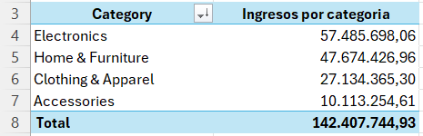
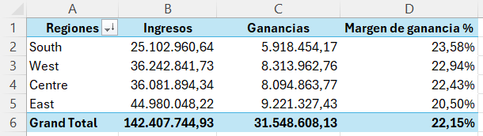
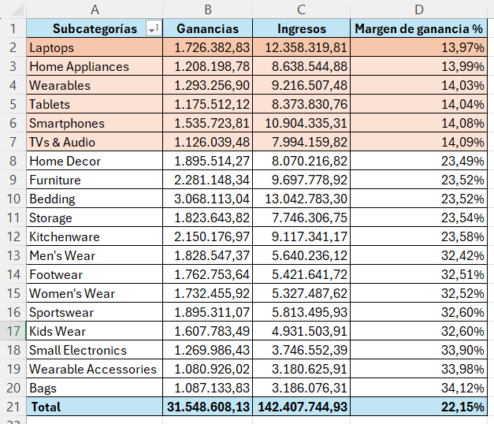
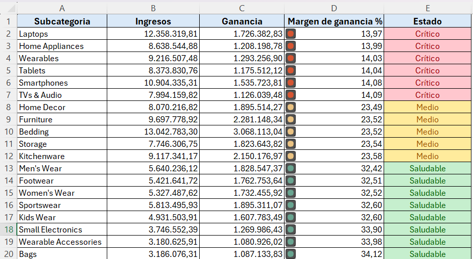

# Análisis de ventas y márgen de ganancia

## Objetivos

1. Analizar un dataset de ventas para medir KPI's financieros y de rentabilidad para identificar los ingresos, márgenes de ganancia y bajos desempeños según la categoría del producto y la región del país donde se venden.

2. Desarrollar un dashboard interactivo para la visualización de los KPI's para la toma de decisiones accionables que impactan al negocio mediante el uso de DAX en Power BI.

## Herramientas y tecnologías utilizadas

1. Excel
2. Power Query en Excel
3. SQL - PostgreSQL
4. Power BI
5. DAX en Power BI

## Proceso de análisis

Este análisis plantea las siguientes interrogantes para identificar las referencias de los KPI's financieros y rentabilidad: 

1. ¿Qué categoría genera más ingreso total?
2. ¿Qué región tiene mejor margen de ganancia?
3. ¿Qué subcategorías están en pérdida?

### Datos utilizados

Este conjunto de datos contiene 200.000 registros de ventas sintéticos que simulan transacciones reales de productos en diferentes regiones de Estados Unidos. 

El conjunto de datos proporciona información detallada sobre las transacciones, incluyendo nombres de clientes, fecha de pedido, categorías y subcategorías de productos, precios, cantidades y detalles de ingresos y ganancias.

### Estructura de los datos

-Filas: 200.000

-Columnas: 14

### Limpieza y transformación

Al conocer que se tienen más de 100 mil registro se usó Power Query para el análisis exploratiorio. Se identificaron anomalías que podrían afectar el análisis por lo tanto se normalizaron y transformaron, como: el uso de la coma como separador de miles y el orden de la fecha (día/mes/año). 
Además, también se eliminaron duplicados y filas en blanco en la columna de order_id.

Posterior se usó Excel para encontrar las respuestas a las preguntas que nos planteamos. Se realizó tres tablas dinámicas con los datos anteriormente normalizados.

### ¿Qué categoría genera más ingreso total?

La categoría que registró mayores ingresos totales fue la de *Electronics* con un valor de: $57.485.698,06.

### ¿Qué región tiene mejor margen de ganancia?

La región *South* registró mejor margen que el resto con 23,58%. Para realizar esto se agregó una nueva columna a la tabla dinámica con la fórmula para determinar el margen Ganancias/Ingresos.

### ¿Qué subcategorías están en pérdida?

Ninguna subcategoría está en pérdida, pero 6 son críticas, teniendo a *Laptops* con el margen de ganancia más bajo 14%. Para realizar esta tabla se creó una nueva hoja, una nueva tabla y las funciones de SUMIF, XLOOKUP, IF para tener una imagen visual sobre el estado de las subcategorías.

## Resultados

1. Electronics es la categoría con más ingreso: $57.485.698,06.
2. South tiene el mejor margen: 23,58 %.
3. Ninguna subcategoría está en pérdida, pero 6 son críticas, todas de Electronics, con márgenes de 13-14 %.
